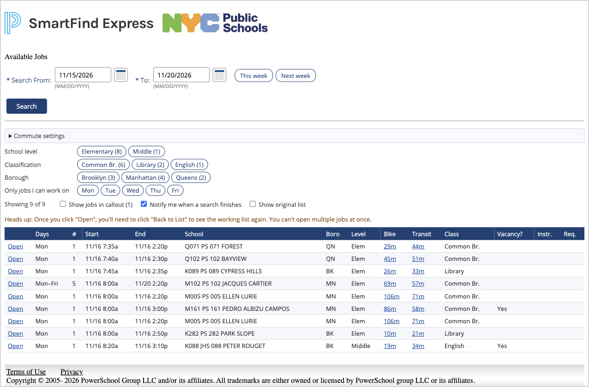

# SubCentral Job Filter

A free Chrome add-on that makes the SubCentral **Available Jobs** page easier to use: filter jobs, sort them, and see how long it takes to bike or take transit to each school.

**Before**


**After**



Works in **Google Chrome** on a computer (not on a phone or tablet).

---

## Set it up (about 5 minutes)

1. **Download:** Go to [the download page](https://github.com/zevezev/Subcentral-Filters-Chrome-Extension), click the green **Code** button, then **Download ZIP**. Double-click the ZIP in your Downloads to unzip it, and move the folder to your **Documents**. Keep this folder; the add-on needs it.
2. **Add to Chrome:** Type **chrome://extensions** in Chrome's address bar. Turn on **Developer mode** (top right), click **Load unpacked** (top left), and pick the folder.
3. **Add your address:** On SubCentral **Available Jobs**, run a search. Type your home address in **Commute settings**, including your borough (for example `123 Main St, Brooklyn, NY 11215`), and click **Save**. Check that the address it found is yours.

That's it! The **Bike** and **Transit** columns fill in on their own.

> Chrome may show a message about "developer mode extensions." That's normal. Just close it.

---

## How to use it

- **Filters:** Click the round buttons (School level, Classification, Borough, days) to narrow the list. Click a button again to turn it off.
- **Sorting:** Click any column title to sort by it. For example, click **Transit** to see the closest schools first.
- **Commute times:** Times are in minutes. **Transit** is the quickest trip that gets you there by the job's start time on a weekday. Click any time to open the trip in Google Maps.
- **Hover** over a commute time to see which school building it found.
- **Notifications:** Check **Notify me when a search finishes**. If no notification shows up, make sure your computer allows notifications from Chrome (on a Mac: **System Settings → Notifications → Google Chrome**).
- **Original list:** Check **Show original list** to see the regular SubCentral page.

> 💡 Clicking **Open** on a job makes SubCentral forget the list, so you'll need to search again afterward. That's how SubCentral works, not this add-on.

---

## Something not working?

**I don't see the new panel on Available Jobs.**
Make sure the add-on is turned on at **chrome://extensions**. Then refresh the SubCentral page.

**It says my address wasn't found, or it found the wrong place.**
Make sure you typed your borough (Brooklyn, Queens, Manhattan, Bronx, or Staten Island), then click **Save** again. If it still doesn't work, try a nearby street corner, such as `5th Ave and 9th St, Brooklyn, NY 11215`.

**A commute time shows "?"**
The add-on couldn't find that school on the map, or couldn't find a route. Hover over the **?** to see why. Click it to look up the trip in Google Maps instead.

**The commute times stopped and there's a red error message.**
The free map service may be busy or down. Wait a few minutes and run your SubCentral search again.

**I moved.**
Open **Commute settings**, type your new address, and click **Save**. The times will update.

---

## Getting updates

1. Download the ZIP again (step 1 of setup) and unzip it.
2. Replace your old folder with the new one (same place, same name).
3. Go to **chrome://extensions** and click the **↻ reload** arrow on **SubCentral Job Filter**.

---

## Privacy

- Your address and settings are saved **only in your own Chrome browser**. There's no account, and nothing is sent to the person who made this add-on.
- Your address is shared only with [Transitous](https://transitous.org/), just to look up commute times. School names are sent to [Photon](https://photon.komoot.io/) to find each school on the map. Nothing else is shared: no name, no login, and no job details.
- The add-on only runs on the SubCentral Available Jobs page.

## Credits

Commute times come from [Transitous](https://transitous.org/sources/), a free, volunteer-run trip planner ([donate](https://transitous.org/donate/)). Schools are found with [Photon](https://photon.komoot.io/). Map data © [OpenStreetMap contributors](https://www.openstreetmap.org/copyright).

This add-on is not made by, or connected to, PowerSchool or the NYC Department of Education.

---

## For developers

To try changes without reloading the extension: in Chrome, save a SubCentral Available Jobs results page (**File → Save Page As… → Webpage, Complete**). Then run:

```
node dev/preview-server.js "/path/to/Available Jobs _  SmartFind Express _ PowerSchool.html"
```

Open http://localhost:8765. The page runs the real `background.js` and `content.js`, with Chrome's extension features swapped for in-page stand-ins (`dev/chrome-shim.js`). Reload the page to pick up edits.

To build the Chrome Web Store upload, bump `version` in `manifest.json` (and the version in the User-Agent in `background.js` and `transitous_rules.json`), then run `sh dev/build-zip.sh`.
