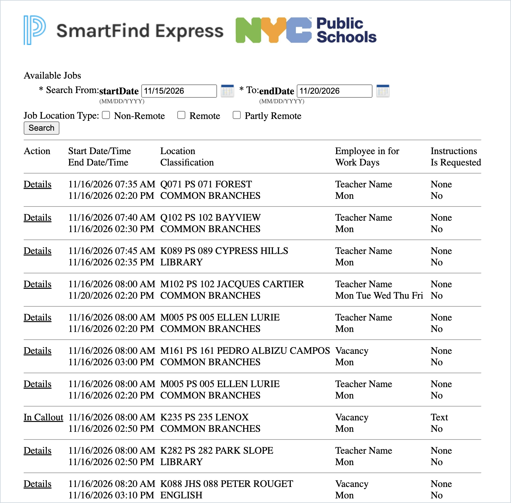

# SubCentral Job Filter

A free Chrome add-on that makes the SubCentral **Available Jobs** page easier to use: filter jobs, sort them, and see how long it takes to bike or take transit to each school.

I am a substitute teacher and software engineer. I built this app using Claude and Curor's coding agent. I did this partially to experiment with vibecoding to see if I could make something useful with it, and to explore the pros and cons.

Despite this being my first chrome extension, I did not learn anything about how to build a chrome extension. I am very excited to have this software to use at my job, but I am sad that I did not learn how chrome extensions work.

More details about this in the "How I used AI to build this" section.

---

**Before**



**After**


Works in **Google Chrome** on a computer (not on a phone or tablet).

---

## Set it up (about 5 minutes)

1. **Download:** Go to [the download page](https://github.com/zevezev/Subcentral-Filters-Chrome-Extension), click the green **Code** button, then **Download ZIP**. Double-click the ZIP in your Downloads to unzip it, and move the folder to your **Documents**. Keep this folder; the add-on needs it.
2. **Add to Chrome:** Type **chrome://extensions** in Chrome's address bar. Turn on **Developer mode** (top right), click **Load unpacked** (top left), and pick the folder.
3. **Add your address:** On SubCentral **Available Jobs**, run a search. Type your home address in **Commute settings**, including your borough (for example `123 Main St, Brooklyn, NY 11215`), and click **Save**. Check that the address it found is yours.

That's it! The **Bike** and **Transit** columns fill in on their own.

> Chrome may show a message about "developer mode extensions." That's normal. Just close it.

---

## How to use it

- **Filter:** Click the round buttons to show only the jobs you want. Click again to turn one off.
- **Sort:** Click a column title. For example, click **Transit** to see the closest schools first.
- **Commute times** are in minutes. Click one to see the trip in Google Maps.
- **Get notified:** Check **Notify me when a search finishes**, then switch tabs while you wait.

> 💡 After you click **Open** on a job, click **Back to List** to get back to this list.

---

## Something not working?

**I don't see the new panel on Available Jobs.**
Make sure the add-on is turned on at **chrome://extensions**. Then refresh the SubCentral page.

**It says my address wasn't found, or it found the wrong place.**
Make sure you typed your borough (Brooklyn, Queens, Manhattan, Bronx, or Staten Island), then click **Save** again. If it still doesn't work, try a nearby street corner, such as `5th Ave and 9th St, Brooklyn, NY 11215`.

**A commute time shows "?"**
The add-on couldn't find that school on the map, or couldn't find a route. Hover over the **?** to see why. Click it to look up the trip in Google Maps instead.

**The commute times stopped and there's a red error message.**
The free map service may be busy or down. Wait a few minutes and run your SubCentral search again.

**I don't get a notification when a search finishes.**
Make sure your computer allows notifications from Chrome. On a Mac: **System Settings → Notifications → Google Chrome**.

**I moved.**
Open **Commute settings**, type your new address, and click **Save**. The times will update.

---

## Getting updates

1. Download the ZIP again (step 1 of setup) and unzip it.
2. Replace your old folder with the new one (same place, same name).
3. Go to **chrome://extensions** and click the **↻ reload** arrow on **SubCentral Job Filter**.

---

## How I used AI to build this

I'm a substitute teacher, and I built this extension with an AI coding assistant (the agent in [Cursor](https://cursor.com)). I decided what the extension should do and tested the results using the extension to search for substitute teaching positions. The AI wrote and changed the code.

**What I did:**

- Chose the features based on what I need when looking for jobs: filters, commute times.
- Tested everything against a real saved SubCentral page, and pointed at parts of the page to say what to change. Examples: "remove this bar," "rename this column to Vacancy?," "default the search to this Friday."
- Made the judgment calls: which free map services to use, what to show and hide, how the privacy wording should read, and publishing as an unlisted Chrome Web Store add-on.
- Pushed back when the AI overcomplicated things, and asked it to start over or keep things simple.
- Set up the GitHub repo and the license myself.

**What the AI did:**

- Found free replacements for Google Maps and tested them live on the schools in my job list: [Photon](https://photon.komoot.io/) to find schools, and [Transitous](https://transitous.org/) for bike and transit times.
- Wrote and changed the extension code: the filters, the table, the commute lookups, and the search form.
- Built a test page, so I could try changes without reloading the extension in Chrome.
- Wrote this README, the privacy policy, and the Chrome Web Store materials. It also made the screenshots, replacing teachers' names with placeholders.
- Checked its own results when something looked off.

AI can make mistakes. If something looks wrong, please [open an issue](https://github.com/zevezev/Subcentral-Filters-Chrome-Extension/issues).

## Privacy

- Your address and settings are saved **only in your own Chrome browser**. There's no account, and nothing is sent to the person who made this add-on.
- Your address is shared only with [Transitous](https://transitous.org/), just to look up commute times. School names are sent to [Photon](https://photon.komoot.io/) to find each school on the map. Nothing else is shared: no name, no login, and no job details.
- The add-on only runs on the SubCentral Available Jobs page.

## Credits

Commute times come from [Transitous](https://transitous.org/sources/), a free, volunteer-run trip planner ([donate](https://transitous.org/donate/)). Schools are found with [Photon](https://photon.komoot.io/). Map data © [OpenStreetMap contributors](https://www.openstreetmap.org/copyright).

This add-on is not made by, or connected to, PowerSchool or the NYC Department of Education.

---

## For developers

To try changes without reloading the extension: in Chrome, save a SubCentral Available Jobs results page (**File → Save Page As… → Webpage, Complete**). Then run:

```
node dev/preview-server.js "/path/to/Available Jobs _  SmartFind Express _ PowerSchool.html"
```

Open http://localhost:8765. The page runs the real `background.js` and `content.js`, with Chrome's extension features swapped for in-page stand-ins (`dev/chrome-shim.js`). Reload the page to pick up edits.

To build the Chrome Web Store upload, bump `version` in `manifest.json` (and the version in the User-Agent in `background.js` and `transitous_rules.json`), then run `sh dev/build-zip.sh`.
